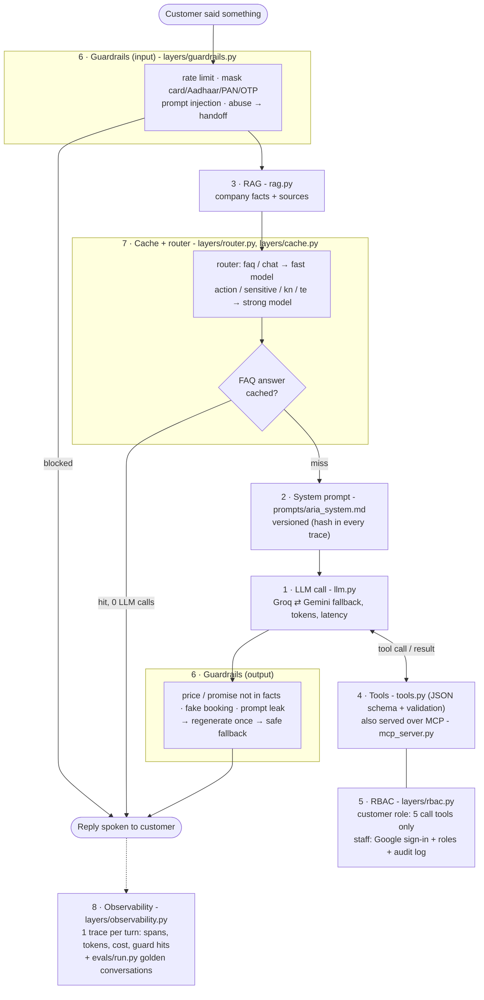
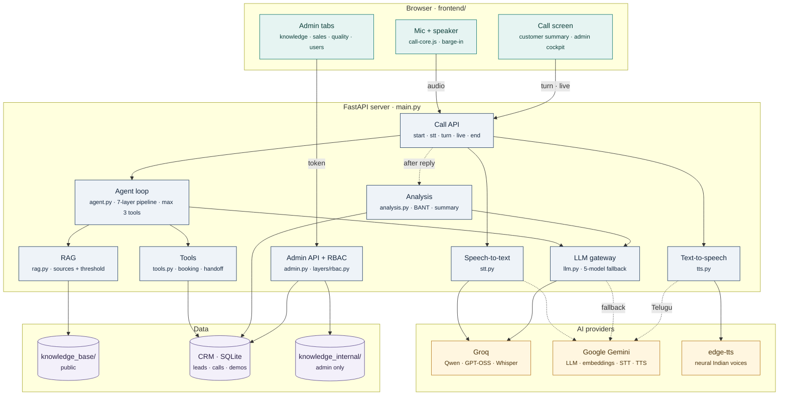
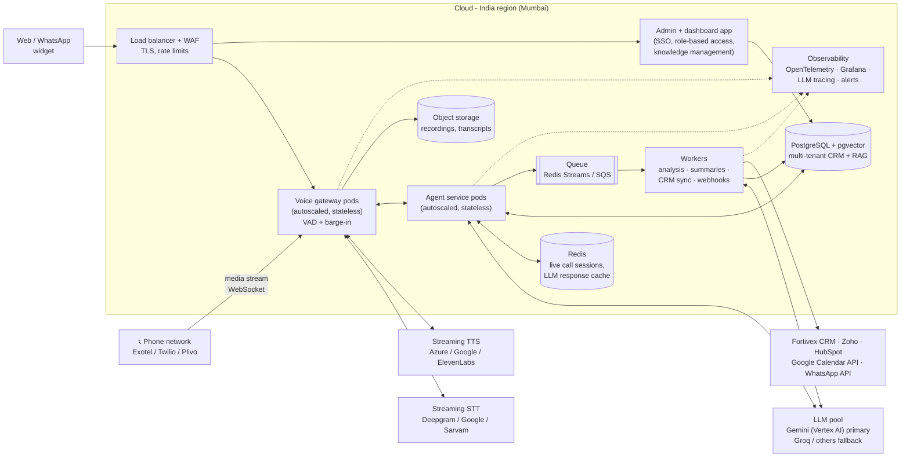

# Architecture

## 0. The 7-layer stack (one customer turn)



| Layer | Fails safe how |
|---|---|
| Guardrails | Code, not prompt: a regex/number check can't be talked out of its rule. One regeneration, then a fixed safe reply |
| Router | Fast tier falls back to the strong list; a tool call switches the rest of the turn to the strong model; empty reply → retry on strong |
| Cache | Key includes knowledge-base hash + prompt version, so new prices or prompt edits invalidate it; only tool-free, guard-clean, impersonal answers are stored |
| RBAC | The page hides what you can't use, but every route and every tool call is checked on the server; role changes apply immediately |
| Observability | A trace write can never break a call (errors are logged, not raised) |

## 1. MVP architecture (what runs today)



### Design principles
| Principle | Where |
|---|---|
| **One gateway per external dependency** so it can be swapped | `llm.py` (LLM), `crm.py` (CRM), `tts.py` (voice) |
| **Fallback at every layer**, so a live call never dies | Groq ⇄ Gemini model chain · slow embeddings → keyword search (circuit breaker) · neural voice → browser voice · LLM down → human handoff |
| **LLM suggests, code decides** | tools validate every argument; lead score is a formula, not an LLM guess |
| **Grounded answers only** | RAG with a minimum-similarity threshold; sources shown for every answer |
| **Nothing slow on the customer's path** | analysis and scoring run as background tasks after the reply is sent |

## 2. One full end-to-end workflow

```mermaid
sequenceDiagram
    autonumber
    actor C as Customer
    participant B as Browser
    participant S as FastAPI (main.py)
    participant A as Agent (agent.py)
    participant R as RAG (rag.py)
    participant L as LLM (Gemini / Groq)
    participant T as Tools + CRM
    participant V as TTS (Gemini TTS / edge-tts)
    participant N as Analysis (background)

    C->>B: "Book a demo tomorrow at 3"
    B->>S: POST /api/call/stt (WAV audio)
    S-->>B: text (Groq Whisper; Gemini as backup)
    B->>S: POST /api/call/turn {session_id, text}
    S->>A: handle_turn()
    A->>R: search(text)
    R-->>A: top chunks + sources (or "no info")
    A->>L: system prompt + facts + history (JSON mode)
    L-->>A: {"tool": "check_availability"}
    A->>T: check_availability()
    T-->>A: free slots
    A->>L: tool result
    L-->>A: {"tool": "book_appointment", "args": {"slot": "2026-11-27 15:00"}}
    A->>T: book_appointment() - validates slot, saves to CRM, builds calendar link
    T-->>A: booked ✔
    A->>L: tool result
    L-->>A: {"reply": "Done! Your demo is booked for...", "language": "en"}
    A-->>S: reply + sources + thoughts + tool trace + latency
    S->>V: speak(reply, "en")
    V-->>S: MP3 (base64)
    S-->>B: JSON response
    B->>C: 🔊 plays reply, shows booking banner
    S-)N: analyze_turn() after response
    N->>L: sentiment + BANT (JSON)
    N->>T: update lead score / status
    B->>S: GET /api/call/{id}/live (polling)
    S-->>B: score, sentiment, BANT, insights → cockpit
    Note over B,S: On "End call": POST /api/call/end → summary + next steps saved in CRM → sales dashboard (admin page).<br/>Next call from the same number loads this summary as memory.
```

## 3. Production architecture (for 1,00,000+ users)



What changes from MVP to production, and what does **not**:
| Layer | MVP | Production | Code impact |
|---|---|---|---|
| Audio in/out | Browser mic, server STT per utterance, Gemini TTS / edge-tts, HTTP per turn | Telephony WebSocket, streaming STT/TTS | new gateway service; agent unchanged |
| Sessions | Python dict | Redis | `SESSIONS` → Redis client |
| CRM | SQLite | PostgreSQL / Fortivex CRM API | one adapter class in `crm.py` |
| RAG index | NumPy in memory, public + internal collections | pgvector, one namespace per client and per collection | inside `rag.search()` only |
| Admin auth | Google sign-in + roles (RBAC), in-memory tokens | Company SSO, tokens in Redis | `_sessions` in `layers/rbac.py` |
| LLM | Free-tier keys | Vertex AI / paid tiers, quota pools | config only |
| Analysis | FastAPI background task | queue + worker pool | move function call to a worker |

Details: [SCALING_SECURITY_COSTS.md](SCALING_SECURITY_COSTS.md).
